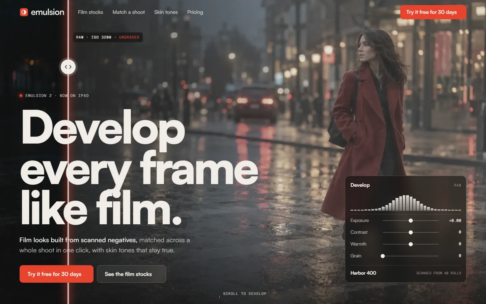

# Emulsion

Develop every frame like film. An invented photo app product, built as one plain HTML page with GSAP, ScrollTrigger, SplitText and Lenis.

**Live:** https://razee4315.github.io/sites/emulsion/

## Art direction

Photo app. Film looks built from scanned negatives, one-click "match this look" across a whole shoot, skin-tone protection, and a Lightroom plugin.

| # | Decision | Answer |
|---|---|---|
| 1 | Aesthetic | **Darkroom cinema.** Near-black, full-bleed photography, one safelight-red accent. |
| 2 | Type | **Satoshi** 900/700 for display, 400/500 for text. **Geist Mono** for slider values. |
| 3 | Palette | `#0C0B0A` darkroom · `#F2EEE8` print white · `#8D8780` silver · `#E8402A` safelight |
| 4 | Scale | Hero `clamp(64px, 11vw, 210px)` over 17px → 12× |
| 5 | Radius | **10px** |
| 6 | Borders | Hairlines in print white at 12%; photos are never boxed |
| 7 | Easing | expo out `cubic-bezier(.16,1,.3,1)`; wipes `cubic-bezier(.77,0,.175,1)` |
| 8 | Signature | **Scroll develops the photo.** The hero frame starts as a flat RAW file; as you scroll it pins and the grade sweeps across it behind a glowing edge while the app's sliders and histogram move in step. Then you can drag the split yourself. |
| 9 | Grid | 12 columns, 24px gutter, 1440px max |
| 10 | Texture | Film grain 5% |

Photography generated with Codex as one shoot; the logo is hand-built SVG in `logo/`. Every brand, person and number is invented. A personal project by [Saqlain](https://github.com/Razee4315).
