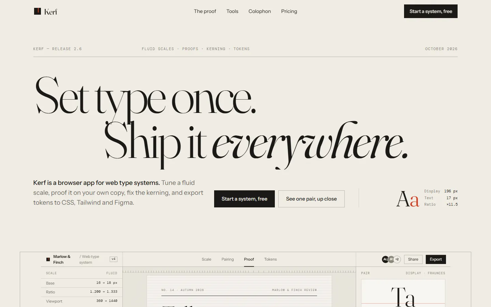

# Kerf

Set type once, ship it everywhere. An invented design tool product, built as one plain HTML page with GSAP, ScrollTrigger, SplitText and Lenis.

**Live:** https://razee4315.github.io/sites/kerf/

## Art direction

Design tool. A browser app for building web type systems: a fluid scale editor that writes the `clamp()` maths, pairing proofs on your own copy, kerning and rhythm checks, and token export to CSS and Figma.

| # | Decision | Answer |
|---|---|---|
| 1 | Named aesthetic | **Foundry proof.** Light, editorial, a printed type specimen with a proofreader's red pencil. |
| 2 | Type | Display: **Fraunces** (opsz 144, weight 300 with a 400 italic accent). Text & UI: **Instrument Sans** 400/500/600. Code labels: **DM Mono**. |
| 3 | Palette | `#F1EDE4` paper · `#1B1A17` ink · `#8C877C` graphite (muted, rules) · `#D23A1E` proof red (one mark per screen) |
| 4 | Scale | Hero `clamp(60px, 10.4vw, 196px)` over 17px body → 11.5× |
| 5 | Radius | **0** — sharp everywhere |
| 6 | Borders | Hairline rules in graphite at 30%; baseline grid shown in the product only |
| 7 | Easing | expo out `cubic-bezier(.16,1,.3,1)`; wipes `cubic-bezier(.77,0,.175,1)` |
| 8 | Signature | **A UI camera move:** a pinned shot of the whole Kerf app that dollies in 1× → 7× onto the "Ta" kerning pair in the proof, where metric lines draw in and the kern value counts to −48, then pulls back out to the exported tokens. |
| 9 | Grid | 12 columns, 28px gutter, 1360px max, asymmetric editorial columns |
| 10 | Texture | Paper grain 3% |

Supporting: masked line reveals · clip-path reveal on the specimen images · counting numbers. Magnetic primary CTA.
Photography: one north-light still-life shoot (empty type case, blank proofs with a red pencil).

Photography generated with Codex as one shoot; the logo is hand-built SVG in `logo/`. Every brand, person and number is invented. A personal project by [Saqlain](https://github.com/Razee4315).
