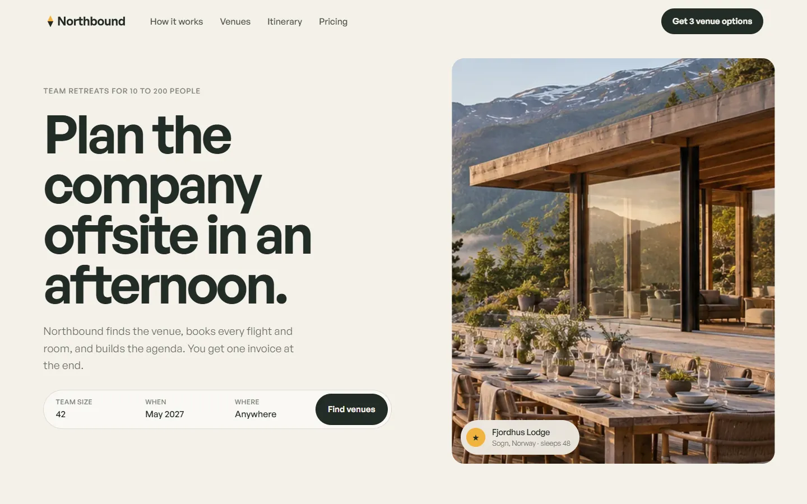

# Northbound

Plan the company offsite in an afternoon. An invented travel product, built as one plain HTML page with GSAP, ScrollTrigger, SplitText and Lenis.

**Live:** https://razee4315.github.io/sites/northbound/

## Art direction

Business travel platform. Venues, flights, rooms and a day-by-day agenda for team retreats of 10 to 200 people, on one invoice.

| # | Decision | Answer |
|---|---|---|
| 1 | Aesthetic | **Sunlit travel editorial.** Warm linen ground, big daylight photography, pine-green ink. |
| 2 | Type | **General Sans** 600 for display, 400/500 for text. |
| 3 | Palette | `#F6F2EA` linen · `#1F2A24` pine · `#7A8077` sage · `#F2B33D` marigold |
| 4 | Scale | Hero `clamp(56px, 9.6vw, 184px)` over 18px → 10.2× |
| 5 | Radius | **22px** |
| 6 | Borders | None; cards separate by tone and photography |
| 7 | Easing | expo out; wipes `cubic-bezier(.77,0,.175,1)` |
| 8 | Signature | **The trip assembles.** A small venue card in the hero grows into a full-bleed photograph as you scroll, and the trip summary builds on top of it: people, nights, flights, rooms, total, each number counting in. |
| 9 | Grid | 12 columns, 24px gutter, 1400px max |
| 10 | Texture | Grain 3% |

Photography generated with Codex as one shoot; the logo is hand-built SVG in `logo/`. Every brand, person and number is invented. A personal project by [Saqlain](https://github.com/Razee4315).
