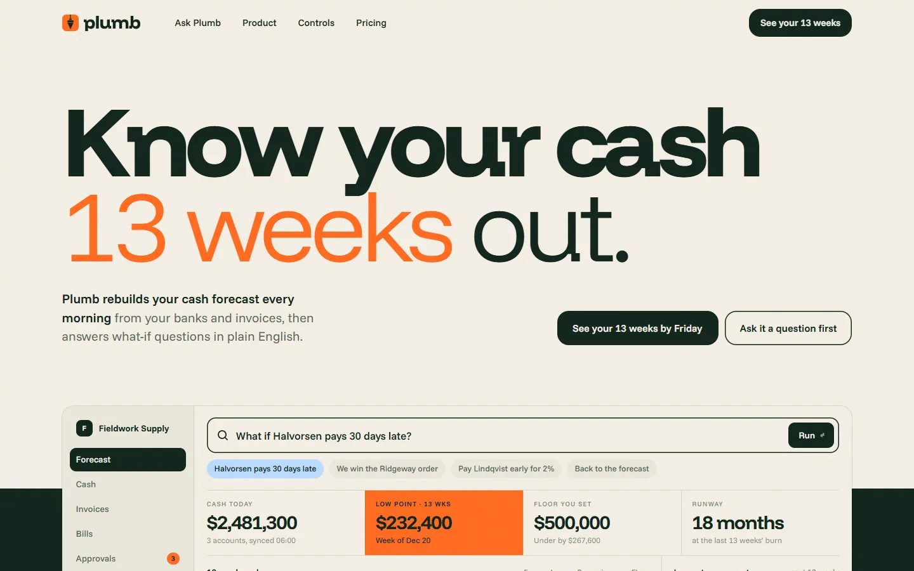

# Plumb

Know your cash 13 weeks out. An invented finance product, built as one plain HTML page with GSAP, ScrollTrigger, SplitText and Lenis.

**Live:** https://razee4315.github.io/sites/plumb/

## Art direction

Finance platform. Cash-flow forecasting for finance teams at 20–500 person companies: bank feeds and invoices in, a rolling 13-week forecast out, scenarios you ask for in plain English, and approvals that hold payments until the forecast says yes.

| # | Decision | Answer |
|---|---|---|
| 1 | Named aesthetic | **Modernist poster.** Bold colour fields, heavy grotesk, hard-shadow still life. |
| 2 | Type | Display: **Funnel Display** 800 with a 300 contrast word. Text & UI: **Funnel Sans** 400/500/600. |
| 3 | Palette | `#F4EFE4` cream · `#10241B` forest (ink) · `#FF6A1F` tangerine (accent, colour field) · `#B9DBFF` sky (second field, scenario line) |
| 4 | Scale | Hero `clamp(60px, 10.8vw, 200px)` over 17px body → 11.7× |
| 5 | Radius | **18px** everywhere (panels and buttons) |
| 6 | Borders | Borderless; separation by colour field. Hairlines only inside tables. |
| 7 | Easing | expo out `cubic-bezier(.16,1,.3,1)`; wipes `cubic-bezier(.77,0,.175,1)` |
| 8 | Signature | **A command bar that types and runs scenarios live:** "What if Halvorsen pays 30 days late?" is typed, run, and the 13-week cash chart redraws a scenario line, the low point moves, and the numbers tick. Visitors can type or pick their own. |
| 9 | Grid | 12 columns, 24px gutter, 1360px max |
| 10 | Texture | Grain 4% |

Supporting: masked line reveals · clip-path reveals on colour fields and photos · counting numbers. Magnetic primary CTA.
Photography: one hard-light studio shoot on seamless colour (brass plumb bob on sky, clipped paper on tangerine, brass discs on forest).

Photography generated with Codex as one shoot; the logo is hand-built SVG in `logo/`. Every brand, person and number is invented. A personal project by [Saqlain](https://github.com/Razee4315).
