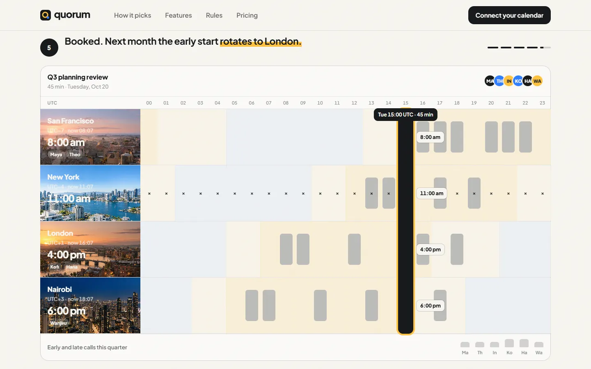

# Quorum

Find the hour that works for everyone. An invented scheduling product, built as one plain HTML page with GSAP, ScrollTrigger, SplitText and Lenis.

**Live:** https://razee4315.github.io/sites/quorum/

## Art direction

Scheduling for distributed teams. Reads everyone's calendar across time zones, proposes the fairest slot, rotates who takes the early and late calls, and moves meetings when plans change.

| # | Decision | Answer |
|---|---|---|
| 1 | Aesthetic | **Day and night.** Bright paper ground; sun yellow for daylight hours, azure for night. |
| 2 | Type | **Plus Jakarta Sans** 800 for display, 400–600 for text. |
| 3 | Palette | `#F7F5F0` paper · `#15171A` ink · `#FFC23D` sun · `#2E7DFF` night |
| 4 | Scale | Hero `clamp(56px, 10vw, 190px)` over 17px → 11× |
| 5 | Radius | **14px** |
| 6 | Borders | Hairlines only inside the time grid |
| 7 | Easing | expo out; wipes `cubic-bezier(.77,0,.175,1)` |
| 8 | Signature | **The fair hour.** A pinned 24-hour band for four cities: availability fills in, a search sweeps the day, and the one hour that is daylight for everyone locks in as a meeting while every local time ticks. Afterwards you can drag the meeting yourself. |
| 9 | Grid | 12 columns, 24px gutter, 1360px max |
| 10 | Texture | Grain 3% |

Shared for all three: a sticky curtain footer that the page lifts off, a giant outlined wordmark, masked line reveals, clip-path image reveals with a scale settle, counting numbers, a magnetic primary CTA, and a full reduced-motion fallback.

Photography generated with Codex as one shoot; the logo is hand-built SVG in `logo/`. Every brand, person and number is invented. A personal project by [Saqlain](https://github.com/Razee4315).
