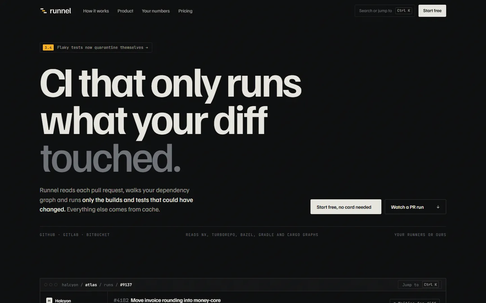

# Runnel

CI that only runs what your diff touched. An invented developer tool product, built as one plain HTML page with GSAP, ScrollTrigger, SplitText and Lenis.

**Live:** https://razee4315.github.io/sites/runnel/

## Art direction

Developer tool. A CI service that reads the pull request diff, walks the dependency graph, and runs only the affected builds and tests, with a shared remote cache and a quarantine for flaky tests.

| # | Decision | Answer |
|---|---|---|
| 1 | Named aesthetic | **Instrument panel.** Dark, Swiss-technical, monochrome with one sodium-lamp accent. |
| 2 | Type | Display: **Familjen Grotesk** 600/700. Text & UI: **JetBrains Mono** 400/500 (labels, terminal, tables). Body paragraphs in Familjen 400. |
| 3 | Palette | `#0B0C0D` graphite (ground) · `#E7E5DF` bone (type, passed) · `#6E7177` slate (muted, skipped) · `#FFB020` sodium (accent: running, the one thing that matters) |
| 4 | Scale | Hero `clamp(56px, 9.6vw, 172px)` over 15px body → 11.4× |
| 5 | Radius | **3px** everywhere |
| 6 | Borders | Hairlines only, `rgba(231,229,223,.1)`; no card shadows |
| 7 | Easing | expo out `cubic-bezier(.16,1,.3,1)`; wipes `cubic-bezier(.77,0,.175,1)` |
| 8 | Signature | **A pinned scroll where one real pull request runs itself:** the diff lands, the dependency graph lights the 4 affected packages, 212 of 1,840 tests get scheduled, cache hits fill in, and the run finishes in 1m 52s against a 14m 08s baseline. |
| 9 | Grid | 12 columns, 24px gutter, 1320px max, 4vw edge |
| 10 | Texture | Grain 4% |

Supporting (max 3): masked line reveals · clip-path reveals on UI panels · counting numbers. Magnetic primary CTA.
Photography: one night shoot, sodium light on a basalt water channel, used once behind the final CTA.

Photography generated with Codex as one shoot; the logo is hand-built SVG in `logo/`. Every brand, person and number is invented. A personal project by [Saqlain](https://github.com/Razee4315).
